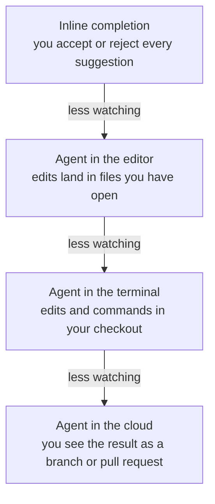

Coding tools differ less in their models than in where they run and how
much they may do without asking. This is the one lesson in the course
with product details in it, and it is dated for that reason: everything
here describes **October 2026**.

<Figure
  slug="agent-kinds-of-coding-tools-cutout"
  alt="Four chunky tools on a long thick platform arranged from small to large: a yellow pencil, a blue power drill, a green robot arm bolted to a workbench, and a red delivery drone carrying one closed crate"
/>

## Four places an agent can run

Strip away the branding and there are four surfaces. They differ in
where the work happens and in how much of it you see as it happens.

* **Inline completion.** Suggestions appear at your cursor as you type,
  as dimmed text you accept with a key or ignore by typing on. There
  is no loop and no tools: the model proposes the next few lines and
  you are the one who decides, one suggestion at a time.
* **An agent in the editor.** A panel in your editor runs the agent
  loop against the project you have open. You watch the edits land in
  your files, usually as a diff you can keep or reject, and its
  commands run in your editor's terminal.
* **An agent in the terminal.** You start it in a shell, in the checkout
  you are standing in, and it reads, edits and runs commands there. You
  see each step scroll past, and whether it stops to ask depends on the
  permission mode.
* **An agent in the cloud.** It runs on the vendor's machines, in a
  disposable environment with a fresh clone of your repository. You
  start it from a web page, an issue, a chat app or your terminal, and
  come back later to a branch or a pull request.

Ordered by how much happens without you watching, they form a line:

The middle two are close, and the permission mode can move either one
a long way along the line: an editor agent allowed to run everything
watches less than a terminal agent that asks before each command. The
ends are fixed. Completion is always one suggestion at a time, and a
cloud agent always works away from your machine, so what you review is
the result rather than the process.

Each vendor also has a desktop app or a web page for starting and
following these agents. Those are different windows onto the same four
surfaces, not a fifth kind.

## Products span several of them

As of October 2026, each of the four best-known products covers at
least three of the surfaces. In the table, "No" means the vendor's own
documentation describes no product of that kind.

| Product | Inline completion | Agent in the editor | Agent in the terminal | Agent in the cloud |
| --- | --- | --- | --- | --- |
| Claude Code[^claude-code] | No | A VS Code extension and a JetBrains plugin | The `claude` CLI | Cloud sessions, which push a branch you can open a pull request from |
| Codex[^codex] | No | The Codex IDE extension, for VS Code and compatible editors; JetBrains and Xcode integrations | The Codex CLI | Codex Cloud, where you review the result and commit or open a pull request |
| Cursor[^cursor] | Tab | Agent, inside the Cursor editor | The Cursor CLI (`agent`) | Cloud Agents, which work on a branch and open pull requests |
| GitHub Copilot[^copilot] | Inline and next edit suggestions | Agent mode in supported IDEs, VS Code among them | Copilot CLI | Copilot cloud agent, which pushes a branch and can open a pull request |

Two things follow from the table. First, "which tool?" is the wrong
first question, because every product gives you most of the surfaces.
"Which surface, for this task?" is the right one, and the last section
of this lesson is about answering it. Second, the same product on two
surfaces behaves more differently than two products on the same
surface. Claude Code in your terminal and Claude Code in the cloud
reach different things and need different amounts of trust; Codex's
CLI and Copilot's CLI are much closer to each other than either is to
its own cloud agent.

Everything in the table is likely to change within months. When it
does, this page is the one to update, and nothing else in the course
should need to move.

## Permission and planning modes, by product

[Tools and Permissions](/courses/working-with-coding-agents/tools-and-permissions)
describes the approval spectrum without product names, and
[Plan Before Code](/courses/working-with-coding-agents/plan-before-code)
describes planning first. These are the names each product uses, as
of October 2026.

### Claude Code

Claude Code calls these **permission modes**. In the terminal,
`Shift+Tab` cycles through them; the VS Code extension and the desktop
app have a mode selector.[^claude-code-modes]

* **Manual** (setting value `default`): asks before most edits,
  commands and network access. Only reads run freely.
* **Accept edits** (`acceptEdits`, labelled "Edit automatically" in VS
  Code): file edits and common file-system commands such as `mkdir`
  and `mv` run without asking.
* **Plan** (`plan`): Claude reads and explores and writes a plan, and
  edits stay blocked until you approve it. Enter it with `Shift+Tab`
  or by starting a prompt with `/plan`.
* **Auto** (`auto`): a separate classifier model reviews actions in
  your place. In current versions it is the mode a terminal or VS Code
  session starts in, where it is available.
* **Don't ask** (`dontAsk`): only pre-approved tools run, and anything
  that would have prompted is refused. Meant for CI and scripts.
* **Bypass permissions** (`bypassPermissions`): everything runs. The
  documentation says to use it only in isolated containers and VMs.

### Codex

Codex separates two layers: the **sandbox**, which sets what it can
technically reach, and the **approval policy**, which sets when it
stops to ask.[^codex-modes]

* In the IDE extension and the ChatGPT desktop app, the permissions
  control under the composer offers, depending on your configuration,
  **Ask for approval** (the recommended starting point: it works inside
  the workspace and pauses before going beyond it), **Approve for me**
  (the same boundary, with requests to cross it sent to an automatic
  reviewer instead of you) and **Full access** (no sandbox and no
  approvals).
* In the CLI, `/permissions` switches between presets such as
  **Auto** (read, edit and run commands in the workspace; ask before
  leaving it or using the network) and **Read Only**.
* Underneath, `sandbox_mode` is `read-only`, `workspace-write` or
  `danger-full-access`, and `approval_policy` is `on-request` or
  `never`. Locally, network access is off by default.
* `/plan` switches a chat into plan mode, in the CLI and in the IDE
  extension. For no changes at all, the documentation suggests the
  `read-only` sandbox.

### Cursor

Cursor has **modes** for what the agent is trying to do and
**Run Modes** for what it may do without asking.[^cursor-modes]

* Modes, shared by the editor and the CLI: **Agent** (all tools),
  **Plan** (asks clarifying questions, researches the code and writes
  an editable plan before any code; `Shift+Tab` switches to it) and
  **Ask** (read-only exploration).
* Run Modes, under Settings > Agents > Approvals & Execution:
  **Auto-review** (allowlisted calls run, other shell commands run in a
  sandbox where possible, and the rest go to a classifier), **Allowlist**
  and **Run Everything**.
* By default, the agent edits files in the workspace without asking,
  configuration files excepted, and asks before terminal commands. Its
  edits are saved to disk immediately, which is one more reason to
  commit before a session.

### GitHub Copilot

Copilot's settings depend on where it runs. In VS Code, they are
**permission levels**, chosen from a dropdown in the chat
input:[^copilot-vscode]

* **Manual permissions** (the default): uses your tool, URL and
  terminal approval settings, and asks about anything not approved in
  advance.
* **Assisted permissions**: an LLM judge assesses each tool call, and
  asks you about the ones it does not approve. Available only for some
  kinds of session.
* **Allow all**: every tool call runs without confirmation.
* **Autopilot** is listed separately, as a mode rather than a level: it
  approves everything, retries on errors, and answers its own questions
  until it decides the task is complete. **Plan** mode is chosen the
  same way, or with `/plan`.

Copilot CLI asks the first time it wants a tool that can change or run
files.[^copilot-cli] Its prompt offers to approve the tool for the rest
of the session, and its documentation spells out what that means:
approve `rm ./this-file.txt` that way and Copilot can run any `rm`
command, `rm -rf ./*` included, for the rest of the session without
asking. Flags such as `--allow-tool`, `--deny-tool` and
`--allow-all-tools` set the rules up front. `Shift+Tab` cycles into
**plan mode**, which blocks edits to project files while it plans, and
into **autopilot mode**, which by default pauses after five automatic
continuations (`--max-autopilot-continues` changes the number).

### Planning modes at a glance

| Product | Planning mode | What the documentation says it does |
| --- | --- | --- |
| Claude Code | Plan, via `Shift+Tab` or `/plan` | Explores and writes a plan; edits stay blocked until you approve it |
| Codex | Plan, via `/plan` | Proposes a plan before implementation; for no edits at all, use `read-only` |
| Cursor | Plan, via `Shift+Tab`; also Ask | Plan writes an editable plan before code; Ask is the read-only mode |
| GitHub Copilot | Plan, via `/plan` in VS Code and Copilot CLI | In Copilot CLI, editing project files is blocked while it plans |

One thing every reviewer-model option has in common is the warning
attached to it. Claude Code's documentation says auto mode "does not
guarantee safety";[^claude-code-modes] Cursor's says "Auto-review is not
a security boundary";[^cursor-modes] VS Code's says the model-based
risk assessment "can make mistakes".[^copilot-vscode] They reduce the
number of prompts. They do not replace a sandbox.

## Managing the context window

[What the Agent Sees](/courses/working-with-coding-agents/what-the-agent-sees)
explains why a long session degrades. All four terminal agents have a
command to summarize the session so far and one to start again with
an empty context:[^context-commands]

| Terminal agent | Summarize the session | Start fresh |
| --- | --- | --- |
| Claude Code | `/compact`, optionally with what to focus on | `/clear` |
| Codex CLI | `/compact` | `/new`, or `/clear` to clear the screen too |
| Cursor CLI | `/summarize` | `/clear` |
| Copilot CLI | `/compact`, optionally with what to focus on | `/clear` or `/new` |

To see how full the window is, Claude Code and Copilot CLI have
`/context`, and Codex CLI shows the remaining capacity in `/status`.
Claude Code and Copilot CLI also compact automatically as the window
fills; Copilot CLI starts at about 80% of the window, in the
background. Both document what survives: after compacting, Claude Code
re-reads the project's `CLAUDE.md` from disk, and Copilot CLI keeps
your original instructions alongside the summary, while its
documentation warns that "minor decisions made early in a long
conversation" may not make it.[^compaction] The window itself is often a
choice: for models that support it, Copilot CLI asks whether to use
the default context size or an extended million-token one, and Cursor
lets you pick the window size for its cloud agents on supported
models.[^context-commands]

## Choosing a surface for a task

The surface follows from the task, and mostly from one question: how
much of this do you need to watch?

* **A small edit while you are already typing:** completion. You read
  each suggestion as it appears, so the review happens as you type.
* **A multi-file change you want to see happen:** an agent in the
  editor or the terminal. Pick whichever you already work in. Keep
  the permission mode tight enough that you see the commands.
* **Exploring code you do not know, or deciding on an approach:** the
  same, in its planning or read-only mode, so nothing changes while
  you are still deciding.
* **A well-specified, test-covered chore you do not need to watch:** a
  cloud agent, reviewed as a pull request. Dependency bumps, a
  mechanical rename, a test for a function that has none.

**The less you watch, the more the task and the tests have to carry.**
In the editor you can catch a wrong turn at the first edit. A cloud
agent's wrong turn arrives finished, forty files later, with a summary
that says it is done. So the cloud is for tasks where "done" can be
checked by something other than the agent: a clear request
([Writing a Task](/courses/working-with-coding-agents/writing-a-task)),
a size you can review in one sitting
([Sizing a Task](/courses/working-with-coding-agents/sizing-a-task)),
and tests that would fail if the work were wrong
([Verifying with Tests](/courses/working-with-coding-agents/verifying-with-tests)).

## What stays the same

Underneath all four surfaces and all four products is the loop from
[What a Coding Agent Is](/courses/working-with-coding-agents/what-a-coding-agent-is):
a model that writes text, a harness that runs tools, and a session that
ends when the model says so. Every one of them reads an instruction
file, fills a context window, produces a diff and stops with a summary
that may or may not match the diff. That is why the rest of this
course names products rarely and teaches the parts that do not change
when the products do: what to ask for, how to read what came back, how
to test it, and how to undo it.

## Concept check

<MultipleChoice
  markdown={`You are choosing a tool for a task. Which question should come first?

- [o] How much of this task do I need to watch?
  > Every major product covers most surfaces, so the useful choice is the surface, and that follows from how closely the work needs watching.
- Which product has the newest and largest model?
  > Products differ less in their models than in where they run and what they may do without asking.
- Which product is cheapest per million tokens?
  > Cost matters, but it does not tell you whether you can review the result of the session.
- Which product has the most integrations available?
  > Integrations add tools and reach. They do not answer how the work will be checked.

Pick the surface for the task first. The product is a smaller decision.`}
/>

<MultipleChoice
  markdown={`A well-specified chore with good test coverage, which you do not need to watch. Which surface fits best?

- Inline completion, accepting one suggestion at a time.
  > Completion makes you watch every line, which is exactly what this task does not need.
- A chat panel, pasting each answer into the files.
  > Chat makes you the harness, running every step yourself.
- [o] A cloud agent, reviewed as a pull request.
  > Clear requirements and good tests are what let you review the result instead of watching the process.
- An agent in your editor, watched edit by edit.
  > That works, but it spends your attention on a task that does not need it.

The less you watch, the more the task description and the tests have
to carry. This task has both.`}
/>

<MultipleChoice
  markdown={`You move the same task from a terminal agent to a cloud agent. What changes the least?

- Where the commands run, and as which user.
  > A terminal agent runs as you on your machine; a cloud agent runs on a disposable one.
- [o] The loop, and your need to review the diff.
  > Both are a model writing tool calls in a harness, and both finish with a summary you have to check against the diff.
- What the agent can reach if something goes wrong.
  > Your laptop is out of reach in the cloud, while the environment's secrets are in reach.
- How the finished work comes back to you.
  > A terminal agent leaves changes in your checkout; a cloud agent returns a branch or a pull request.

Surfaces change where the work happens and what it can reach. The loop
and the review stay the same everywhere.`}
/>

[^claude-code]:
    Anthropic, Claude Code documentation:
    [Overview](https://code.claude.com/docs/en/overview) (terminal, VS
    Code, JetBrains, desktop and web surfaces) and
    [Use Claude Code in the cloud](https://code.claude.com/docs/en/claude-code-on-the-web)
    (cloud sessions run in an Anthropic-managed VM, clone from GitHub
    and push branches; a pull request can be created from
    claude.ai/code). Checked October 2026.

[^codex]:
    OpenAI, Codex documentation: [Codex CLI](https://learn.chatgpt.com/docs/codex/cli),
    [Codex IDE extension](https://learn.chatgpt.com/docs/codex/ide)
    (VS Code, Cursor and Windsurf; Xcode and JetBrains IDEs through
    their own integrations) and [Codex Cloud](https://learn.chatgpt.com/docs/cloud)
    ("review the changes and test results, request follow-ups, and
    commit or open a pull request when ready"). The older
    developers.openai.com/codex addresses redirect to these pages.
    Checked October 2026.

[^cursor]:
    Cursor documentation: [Tab completion](https://cursor.com/help/ai-features/tab),
    [Cursor Agent](https://cursor.com/docs/agent/overview),
    [Cursor CLI](https://cursor.com/docs/cli/overview) and
    [Cloud Agents](https://cursor.com/docs/cloud-agent) (cloud agents
    "clone your repo ... and work on a separate branch, then push
    changes to your repo for handoff", and can open pull requests).
    Checked October 2026.

[^copilot]:
    GitHub documentation: [Where to use GitHub Copilot](https://docs.github.com/en/copilot/get-started/where-to-use-github-copilot),
    [GitHub Copilot in IDEs](https://docs.github.com/en/copilot/concepts/copilot-surfaces/copilot-in-ides)
    (inline suggestions, next edit suggestions and agentic features;
    availability varies by IDE),
    [GitHub Copilot CLI](https://docs.github.com/en/copilot/concepts/copilot-surfaces/copilot-cli)
    and [GitHub Copilot on GitHub.com](https://docs.github.com/en/copilot/concepts/copilot-surfaces/copilot-on-github)
    (Copilot cloud agent works in an ephemeral cloud development
    environment, handles branch creation and pushing, and creates a
    pull request on request). Checked October 2026.

[^claude-code-modes]:
    Anthropic, [Choose a permission mode](https://code.claude.com/docs/en/permission-modes),
    Claude Code documentation. Checked October 2026.

[^codex-modes]:
    OpenAI, Codex documentation: [Permissions](https://learn.chatgpt.com/docs/permission-modes),
    [Sandbox](https://learn.chatgpt.com/docs/sandboxing),
    [Agent approvals & security](https://learn.chatgpt.com/docs/agent-approvals-security)
    and [Codex CLI commands](https://learn.chatgpt.com/docs/developer-commands?surface=cli)
    (`/permissions` and `/plan`). Checked October 2026.

[^cursor-modes]:
    Cursor documentation: [Cursor CLI](https://cursor.com/docs/cli/overview)
    (Agent, Plan and Ask modes), [Plan Mode](https://cursor.com/docs/agent/plan-mode),
    [Run Modes](https://cursor.com/docs/agent/security/run-modes) and
    [Agent Security](https://cursor.com/docs/agent/security) (default
    approvals for edits and terminal commands). Checked October 2026.

[^copilot-vscode]:
    Visual Studio Code documentation: [Manage approvals and permissions](https://code.visualstudio.com/docs/agents/run/approvals)
    and [Plan work with agents in VS Code](https://code.visualstudio.com/docs/agents/run/planning).
    Checked October 2026.

[^copilot-cli]:
    GitHub documentation: [GitHub Copilot CLI](https://docs.github.com/en/copilot/concepts/copilot-surfaces/copilot-cli)
    (approval prompts, `--allow-tool`, `--deny-tool`, `--allow-all-tools`
    and plan mode), [Allowing GitHub Copilot CLI to work autonomously](https://docs.github.com/en/copilot/concepts/agents/copilot-cli/autopilot)
    (autopilot mode and its continuation limit) and the
    [Copilot CLI command reference](https://docs.github.com/en/copilot/reference/copilot-cli-reference/cli-command-reference)
    (`/plan` blocks edits to project files). Checked October 2026.

[^context-commands]:
    Claude Code [commands](https://code.claude.com/docs/en/commands);
    Codex [CLI commands](https://learn.chatgpt.com/docs/developer-commands?surface=cli);
    Cursor [CLI slash commands](https://cursor.com/docs/cli/reference/slash-commands)
    and [Cloud Agents](https://cursor.com/docs/cloud-agent) (context
    window size); GitHub [Copilot CLI](https://docs.github.com/en/copilot/concepts/copilot-surfaces/copilot-cli)
    (`/compact`, `/context`, extended context) and the
    [Copilot CLI command reference](https://docs.github.com/en/copilot/reference/copilot-cli-reference/cli-command-reference).
    Checked October 2026.

[^compaction]:
    Anthropic, [Explore the context window](https://code.claude.com/docs/en/context-window)
    ("What survives compaction") and
    [Use Claude Code in the cloud](https://code.claude.com/docs/en/claude-code-on-the-web)
    (automatic compaction); GitHub,
    [Managing context in GitHub Copilot CLI](https://docs.github.com/en/copilot/concepts/agents/copilot-cli/context-management)
    (when compaction starts, and what it does and does not preserve).
    Checked October 2026.
