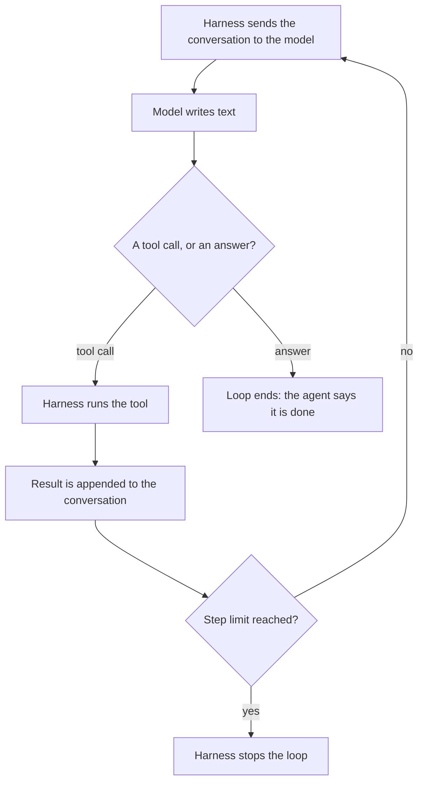

Take away the interface and a coding agent is three things: a language
model, a set of tools it can ask for, and a loop that runs those tools
and feeds the results back. Every behavior you will see from an agent,
good or bad, comes from one of the three.

<Figure
  slug="agent-what-is-an-agent-cutout"
  alt="A deep blue cabinet with a slot in its front and a chunky red toolbox on a thick platform, joined by one thick yellow conveyor belt that runs in a closed loop from the cabinet to the toolbox and back"
/>

## The model only produces text

The model at the center of an agent is the same kind of model that
answers questions in a chat window. As
[What a Language Model Is](/courses/how-llms-work/what-a-language-model-is)
puts it, it takes a sequence of tokens and predicts which token comes
next, over and over. It has no hands. It cannot open a file, run a
command or press a key. All it can do is write text.

So how does an agent edit your code? Along with your request, the
program around the model sends a description of every tool it offers
and the exact format for asking for one. When the model wants to read
a file, it writes a request in that format:

```json
{"tool": "read_file", "args": ["pricing.py"]}
```

That line is not an action. It is text, produced by the same
next-token prediction as everything else the model writes, which
happens to be shaped like something a program can parse. Each product
has its own format for these requests, but every one of them is text
in an agreed shape: a tool name plus its arguments.

Two consequences follow, and the rest of the course leans on both.

* **The model never sees your repository.** It sees text: the contents
  a tool returned, the output of a command, an error message. If a tool
  returned only part of a file, the model works from that part. If it
  never opened a file, that file does not exist as far as the model is
  concerned.
* **A tool call can be wrong the way any text can be wrong.** The model
  can ask for a file that is not there, or call a function it invented,
  with exactly the same fluency as when it is right.
  [Why Models Hallucinate](/courses/how-llms-work/why-models-hallucinate)
  explains why fluency and accuracy come apart; in an agent, the
  invention shows up as a tool call instead of a sentence.

## The harness runs the tools

The program around the model is called the **harness**. It sends the
conversation to the model, reads the reply, and if the reply is a tool
call, runs that tool and appends the result to the conversation. Then
it sends the longer conversation back to the model and waits for the
next reply. Claude Code, the Codex CLI, Cursor's agent and GitHub
Copilot's agent mode are all harnesses.

The harness owns everything that touches your machine: the file
system, the shell, the network, and the prompts that ask you before a
command runs. The model asks; the harness decides whether to do it.
That is why two agents running the same model can behave quite
differently. They give the model different tools, different
instructions and different rules about what needs your approval.
[Tools and Permissions](/courses/working-with-coding-agents/tools-and-permissions)
covers those rules.



The harness also decides what a failure looks like, and the answer is
usually: more text. When a tool fails, the harness does not crash. It
turns the failure into a message and appends it like any other result,
and the model has to make sense of it on the next step.

Here is the loop from the [Welcome page](/courses/working-with-coding-agents),
with two changes. The "model" now writes its tool calls as text, and
the harness parses that text before running anything. And its second
request asks for a test file under the wrong name:

<CodeBlock
  adapter="python"
  files={[
    {
      filename: "main.py",
      starterCode: `import json

# The loop from the Welcome page, with two changes. The "model" writes
# its tool calls as text, the way a real one does, and the harness
# parses that text before running anything. And one of its requests
# names a file that does not exist.

files = {
    "calc.py": "def add(a, b):\\n    return a - b\\n",
    "test_calc.py": "from calc import add\\n\\n\\ndef test_add():\\n    assert add(2, 3) == 5\\n",
}

def read_file(path):
    if path not in files:
        return f"error: no such file: {path}"
    return files[path]

def list_files():
    return "\\n".join(sorted(files))

def edit_file(path, old, new):
    if path not in files:
        return f"error: no such file: {path}"
    if old not in files[path]:
        return f"error: {old!r} not found in {path}"
    files[path] = files[path].replace(old, new)
    return f"edited {path}"

def run_tests():
    namespace = {}
    exec(files["calc.py"], namespace)
    result = namespace["add"](2, 3)
    if result == 5:
        return "1 passed"
    return f"1 failed: add(2, 3) returned {result}, expected 5"

TOOLS = {
    "read_file": read_file,
    "list_files": list_files,
    "edit_file": edit_file,
    "run_tests": run_tests,
}

# Everything the scripted model will say, one reply per step.
SCRIPT = [
    '{"tool": "run_tests", "args": []}',
    '{"tool": "read_file", "args": ["calc_test.py"]}',
    '{"tool": "list_files", "args": []}',
    '{"tool": "read_file", "args": ["test_calc.py"]}',
    '{"tool": "edit_file", "args": ["calc.py", "a - b", "a + b"]}',
    '{"tool": "run_tests", "args": []}',
    '{"answer": "Fixed add(): it subtracted instead of adding. The test passes."}',
]

def model(transcript):
    """Stands in for the language model: returns its next piece of text."""
    steps_taken = len(transcript) - 1
    return SCRIPT[steps_taken]

transcript = ["user: the tests are failing, please fix them"]
print(transcript[0])

while True:
    text = model(transcript)            # the model only writes text
    print(f"model: {text}")
    request = json.loads(text)          # the harness parses it
    if "answer" in request:
        print(f"agent: {request['answer']}")
        break
    tool = TOOLS.get(request["tool"])
    if tool is None:
        result = f"error: no tool called {request['tool']}"
    else:
        result = tool(*request["args"])  # the harness runs the tool
    for line in result.splitlines():
        print(f"    {line}")
    transcript.append((text, result))   # and the result goes back in
`,
    },
  ]}
/>

Look at the fourth and fifth lines of output. The read failed, the
error came back as an ordinary tool result, and the loop carried on.
In this script the next step (listing the files) was written in
advance. A real model reads the error in the transcript and chooses
its next step from it. Usually it chooses well. Sometimes it carries on
as if the read had worked.

Make it do the second thing. In `SCRIPT`, change `"calc.py"` in the
`edit_file` line to `"calc_test.py"`, delete the second `run_tests`
line, and run it again. The edit fails, the bug stays, and the closing
message still says the test passes. Two lines apart, the transcript
says one thing and the summary says the opposite, and nothing in the
loop compares them.

One more: rename `list_files` to `find_files` in its `SCRIPT` line. A
model can ask for a tool that does not exist as easily as a file that
does not exist, and the harness answers that with text too.

## The loop ends when the model says so

A session stops in one of three ways:

* **The model writes an answer instead of a tool call.** This is the
  normal ending, the closing summary.
* **The harness hits a limit.** A cap on steps, tokens, money or time,
  set by the tool or by you.
* **You interrupt it.**

Only the first is the agent deciding it is finished, and it is a
judgment, not a check. The model wrote a sentence that says "done"
because, given everything in the transcript, that sentence seemed like
the right next thing to write. Nothing in the loop requires a final
test run first, or compares the claim with the request. You saw the
consequence on the Welcome page, and again in the exercise above: the
closing message reads the same whether or not the work was verified.

That is the thread through this whole course. **"Done" is a claim the
model makes.** The diff is the record of what it did
([Reading the Diff](/courses/working-with-coding-agents/reading-the-diff)),
and the tests are how you check it
([Verifying with Tests](/courses/working-with-coding-agents/verifying-with-tests)).

The second way of stopping matters when the model never writes an
answer at all. A model that keeps trying the same failing fix can loop
for as long as the harness lets it, so harnesses put a ceiling on the
loop. Here is one. The scripted model alternates between two wrong
fixes and never says it is finished:

<CodeBlock
  adapter="python"
  files={[
    {
      filename: "main.py",
      starterCode: `# The same loop with a step limit, and a scripted model that never
# writes an answer: it alternates between two wrong fixes forever.
# (Tool calls are plain tuples again, to keep the script short.)

MAX_STEPS = 8

files = {"calc.py": "def add(a, b):\\n    return a - b\\n"}

def edit_file(path, old, new):
    if old not in files[path]:
        return f"error: {old!r} not found in {path}"
    files[path] = files[path].replace(old, new)
    return f"edited {path}"

def run_tests():
    namespace = {}
    exec(files["calc.py"], namespace)
    result = namespace["add"](2, 3)
    if result == 5:
        return "1 passed"
    return f"1 failed: add(2, 3) returned {result}, expected 5"

TOOLS = {"edit_file": edit_file, "run_tests": run_tests}

PATTERN = [
    ("run_tests", ()),
    ("edit_file", ("calc.py", "a - b", "b - a")),
    ("run_tests", ()),
    ("edit_file", ("calc.py", "b - a", "a - b")),
]

def model(transcript):
    """Never answers. Repeats PATTERN for as long as it is asked."""
    steps_taken = len(transcript) - 1
    return PATTERN[steps_taken % len(PATTERN)]

transcript = ["user: the tests are failing, please fix them"]
print(transcript[0])

for step in range(1, MAX_STEPS + 1):
    tool, args = model(transcript)
    if tool == "finish":
        print(f"agent: {args[0]}")
        break
    result = TOOLS[tool](*args)
    print(f"step {step}: {tool}({', '.join(map(repr, args))})")
    print(f"        {result}")
    transcript.append((tool, args, result))
else:
    print()
    print(f"harness: stopped after {MAX_STEPS} steps without an answer.")
    print("calc.py is now:")
    print(files["calc.py"])
`,
    },
  ]}
/>

The last lines come from the harness, not the model. The model never
decided to stop; it was stopped. A limit like this keeps a stuck
session from running forever, but it cannot tell you whether more
steps would have helped. Here they would not: raise `MAX_STEPS` to 20
and you get twenty steps of the same two edits.

Now fix the model's second edit: change its replacement from `"a - b"`
to `"a + b"`. The tests pass at step 5, and the loop keeps going
anyway, because a passing test is just another tool result. Only an
answer ends the loop. Passing tests make a good answer *more likely*;
they do not produce one. Real sessions show the same pattern, and
[When to Take Over](/courses/working-with-coding-agents/when-to-take-over)
is about spotting it before the limit does.

## Completion, chat and agents

AI coding tools come in three broad kinds, and the difference between
them is not the model. It is who runs the tools.

| Kind | What the model produces | Who runs anything |
| --- | --- | --- |
| Inline completion | The next few lines, at your cursor, as you type | Nobody: you accept the text or keep typing |
| Chat | An answer in a side panel, often with code in it | You: you copy, paste, run, and paste the error back |
| Agent | Tool calls, then a closing summary | The harness, in a loop, until the model answers |

Completion has no loop and no tools. Chat has a loop, but you are the
harness: you decide which files to show the model, you run its code,
and you carry the result back. An agent moves that job into a program.
That is what makes it fast, and it is also why everything else in this
course exists. When you stop running every step yourself, you stop
seeing every step, so you need other ways to know what happened.

Most products now offer more than one of these, often in the same
window. [Kinds of Coding Tools](/courses/working-with-coding-agents/kinds-of-coding-tools)
maps the real ones onto them.

## Concept check

<MultipleChoice
  markdown={`Which part of a coding agent actually writes changes to your disk?

- The language model, when it writes the edit.
  > The model only produces text. An edit it writes is a request until something carries it out.
- The model provider's servers, which run the code.
  > The provider runs the model. File edits happen wherever the harness runs, which is often your own machine.
- [o] The harness, when it runs an edit tool.
  > The harness parses the model's tool call and performs it, which is also why it is the part that can ask your permission first.
- Your editor, which saves whatever the model types.
  > An editor can host a harness, but the agent's edits come from tool calls the harness carries out.

The model asks and the harness acts. Everything that touches your
files, shell or network goes through the harness.`}
/>

<MultipleChoice
  markdown={`An agent's closing message says "all tests pass", but its transcript shows no test run after its last edit. What in the loop allowed that?

- [o] The loop ends whenever the model writes an answer.
  > Writing the summary is the model's choice. Nothing in the loop requires a test run before it, or checks the claim against the transcript.
- The harness skipped the final test run to save time.
  > A harness runs the tools the model asks for. Here the model never asked.
- The test runner crashed and the harness hid the error.
  > A failed tool comes back to the model as text, the same as a successful one.
- The model ran the tests in its head and trusted the result.
  > The model cannot run anything. It can only write a request for a tool, and here it wrote an answer instead.

"Done" is a claim the model makes. The transcript, the diff and the
tests are how you check it.`}
/>

<MultipleChoice
  markdown={`An agent asks its read tool for \`utils/helpers.py\`, a file that does not exist. What happens next?

- The harness ends the session and reports a crash.
  > A failed tool call is an ordinary event in the loop, not a reason to stop it.
- The model is interrupted in the middle of its reply.
  > The model has already finished writing the tool call by the time the harness tries to run it.
- The harness quietly reads the closest matching file instead.
  > The harness runs the call it was given. Guessing a different file would hide the mistake.
- [o] An error message comes back as the tool's result.
  > The failure becomes text in the transcript, and the model decides on the next step from there.

Errors are just more text in the conversation. What the agent does with
one depends on the model reading it.`}
/>
