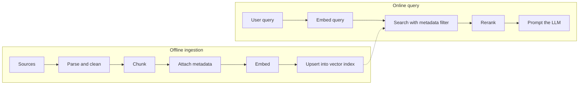

A retrieval-augmented assistant is only as good as the documents it can find,
and finding them is a data pipeline: extract, clean, split, embed, index, keep
fresh, delete on request. That is why "design the ingestion pipeline for an
assistant over our support tickets" has joined "design a clickstream pipeline"
as a data engineering system design question. The fundamentals carry over
directly (idempotency, incremental loads, backfills, schema evolution); the
new parts are the vector store and the cost of the embedding model.

<Figure
  slug="interview-data-engineer-pipelines-for-ai-cutout"
  alt="A brown beaver on a pale grey platform feeding one long blue block into a chunky cutting machine that drops three shorter blue blocks into the deep drawers of one sturdy green cabinet"
/>

## Q&A

### How have Data Engineer interviews changed with AI?

SQL, modeling, and batch and streaming design are still the core of the loop.
What has been added:

- **System design for AI data**: a RAG ingestion pipeline, an embedding
  refresh strategy, or a pipeline that prepares training and evaluation data.
- **Unstructured data**: parsing PDFs, HTML, and tickets into clean text with
  useful metadata, which most warehouse pipelines never had to do.
- **Vector search trade-offs**: exact versus approximate search, index types,
  and filtering.
- **AI in your own workflow**: assistant-written pipeline code is common, and
  some coding rounds now allow an assistant and grade how you verify what it
  produces (see [AI-assisted coding](/interview-prep/backend-engineer/ai-assisted-coding)).
  For pipeline code, verification means idempotency, partition overwrite
  behavior, time zones, and schema drift.

### Walk through the ingestion pipeline for a RAG assistant.

Two halves: an offline pipeline that builds the index, and an online path that
queries it.

The offline half is where most of the engineering lives:

- **Extract** with the same incremental patterns as any source: change data
  capture or an updated-at watermark, never a full re-crawl if you can avoid it.
- **Parse and clean**: strip navigation and boilerplate, keep headings and
  table structure, and deduplicate. Exact duplicates by hash, near duplicates
  by MinHash or similar.
- **Chunk** into passages sized for retrieval (next question).
- **Attach metadata** to each chunk: source document id, section, timestamps,
  language, and **access-control lists**. Metadata is what makes filtering,
  citations, freshness, and deletion possible.
- **Embed and upsert** idempotently, keyed by a stable chunk id, so a retried
  batch overwrites rather than duplicates.

### How do you choose a chunking strategy?

It is a precision and context trade-off. **Small chunks** match a query
precisely but can lose the surrounding context the answer needs. **Large
chunks** keep context, but one vector has to summarize several topics, so
retrieval gets fuzzier, and each retrieved chunk spends more of the context
window. Common choices:

- **Fixed size with overlap**, for example 300 to 500 tokens with a 10% to 20%
  overlap so a sentence split at a boundary appears whole in one chunk.
- **Structure-aware**: split on headings, paragraphs, or ticket messages,
  then merge or split to stay near the target size. Usually better for
  documents with real structure.
- **Small-to-big**: retrieve on small chunks but send the parent section to
  the model.

There is no universal best. Pick by measuring retrieval recall on a labeled
set of real questions, and record the chunking parameters with the index
version, since changing them means rebuilding.

### How do you keep embeddings fresh without re-embedding everything?

Treat it as an incremental load keyed by content:

1. Derive a **stable chunk id** (document id plus position or section) and a
   **content hash** for each chunk.
2. On each run, compare against what is indexed: **embed only chunks whose hash
   changed or that are new**, and **delete chunks that no longer exist**.
3. Propagate deletes from the source. A document removed upstream that stays
   in the index keeps answering questions, which is wrong at best and a data
   leak at worst.

The plan itself is a comparison of two maps from chunk id to content hash:

<CodeBlock
  adapter="python"
  files={[
    {
      filename: "main.py",
      starterCode: `# chunk id -> content hash
indexed = {"doc1#0": "aa", "doc1#1": "bb", "doc2#0": "cc"}  # in the vector index
current = {"doc1#0": "aa", "doc1#1": "zz", "doc3#0": "dd"}  # in the sources now

to_embed = sorted(cid for cid, h in current.items() if indexed.get(cid) != h)
to_delete = sorted(cid for cid in indexed if cid not in current)

print("embed: ", to_embed)   # changed or new
print("delete:", to_delete)  # gone from the source`,
    },
  ]}
/>

`doc1#0` is unchanged and costs nothing. Only the changed and new chunks pay
for an embedding call, and the removed document leaves the index.

### What changes when you switch embedding models?

Everything has to be re-embedded. Vectors from two different models live in
different spaces, so a query embedded with the new model cannot be compared
with documents embedded with the old one. Treat it like a blue/green
deployment: build a **new index version** alongside the old, backfill it,
evaluate retrieval quality on both, then switch an alias atomically and keep the
old index for rollback. Store the embedding model and version on every vector so
a mixed index can never happen silently.

### Exact or approximate nearest-neighbor search?

**Exact search** compares the query with every vector: $O(n \cdot d)$ per
query for $n$ vectors of dimension $d$. That is simple and perfectly accurate,
and fine into the hundreds of thousands of vectors, especially with a filter
that narrows $n$ first. Beyond that, **approximate** indexes trade a little
recall for large speedups:

- **HNSW** (a layered proximity graph): high recall at low latency, but
  memory-hungry, and slower to build and update.
- **IVF** (cluster the vectors, search only the nearest clusters): less memory
  and faster builds; recall depends on how many clusters you probe. Often
  combined with **product quantization** to compress vectors further.

Each exposes a knob (HNSW's search breadth, IVF's number of probes) that trades
recall for latency. Measure recall against exact search on a sample rather than
trusting defaults.

### Should you use pgvector or a dedicated vector database?

If the data already lives in Postgres and the corpus is in the millions of
vectors rather than billions, **pgvector** is a strong default: one system, real
transactions, joins against your relational data, and access-control filters in
plain SQL. A **dedicated vector database** earns its operational cost at very
large scale, very high query rates, or when you need features such as built-in
hybrid search and multi-tenancy at that scale. Say which way you would lean and
what evidence would change your mind.

### Why do metadata filters make vector search harder?

Because the index is built for similarity, not for your filter. **Post-filtering**
(search, then drop results the user may not see) can return far fewer than k
results when the filter is selective. **Pre-filtering** (restrict, then
search) is correct but can defeat the approximate index. Good answers mention
partitioning by tenant, indexes or engines that filter during the search, and
testing with realistic, selective filters rather than none.

### What is hybrid search, and when do embeddings alone fail?

Embeddings capture meaning but blur exact tokens: error codes, product SKUs,
names, and rare jargon. **Hybrid search** runs a keyword search (BM25)
alongside the vector search and fuses the two rankings, commonly with
**reciprocal rank fusion**, which scores each document by
$\sum 1 / (k + \text{rank})$ across the lists, with $k$ around 60. It is cheap
to add and usually helps on technical content.

### How do access control and deletion work in a RAG pipeline?

Carry permissions as chunk metadata and **filter at query time with the
requesting user's identity**, so the assistant can only retrieve what that user
could open directly. Redact or exclude secrets and personal data before
embedding, especially if the embedding model is an external API. And make
deletion real: a right-to-erasure request or a removed document must delete the
vectors, the cached chunks, and any copies in evaluation sets, not just the
source row.

### How do you estimate the cost and time of an embedding backfill?

Count tokens. Ten million chunks at about 400 tokens each is four billion
tokens. Divide by the provider's price per million tokens for cost, and by your
rate limit in tokens per minute for wall-clock time. Then design for the run
to fail partway: batch requests, retry with backoff on rate limits, checkpoint
progress, and make upserts idempotent so a restart resumes rather than starts
over. Content hashing pays for itself here too: unchanged chunks are never
embedded twice.

## Concept checks

<MultipleChoice
  markdown={`Your team switches to a newer embedding model. What is the right migration plan for the vector index?

- Embed only new documents with the new model and keep the old vectors.
  > Query vectors from the new model cannot be compared with document vectors from the old one; the mixed index silently degrades.
- Re-embed everything in place in the live index, batch by batch.
  > During the backfill the live index is a mix of two vector spaces, and there is no clean rollback.
- [o] Build a new index version with the new model, evaluate it, then switch an alias atomically.
  > A blue/green rebuild keeps one consistent space live at all times and leaves the old index for rollback.
- Average the old and new vectors for each document.
  > Vectors from different models are not in a shared space, so averaging them is meaningless.`}
/>

<MultipleChoice
  markdown={`An assistant answers questions about internal policies. A policy page was deleted from the wiki last month, but the assistant still quotes it. What most likely failed?

- The chunk size was too large.
  > Chunk size affects retrieval quality, not whether deleted content stays in the index.
- [o] Deletes from the source were never propagated to the vector index.
  > Incremental sync has to remove chunks whose documents no longer exist; otherwise they keep being retrieved.
- The embedding model was out of date.
  > A stale model hurts relevance; it does not resurrect deleted documents.
- The LLM memorized the policy during pretraining.
  > An internal page from last month is not in a model's pretraining data; it came from your index.`}
/>

<MultipleChoice
  markdown={`Users search a support assistant for error code "E-4031" and get unrelated results, though a ticket with that exact code exists. What is the most likely fix?

- Increase the embedding dimension.
  > More dimensions do not make an embedding preserve rare exact tokens.
- Use larger chunks so more context is embedded.
  > Larger chunks dilute the code further among other text.
- Lower the temperature of the generation model.
  > The failure is in retrieval, before the model generates anything.
- [o] Add keyword search alongside vector search and fuse the rankings.
  > BM25 matches exact tokens such as codes and SKUs, which embeddings tend to blur. Hybrid search covers both.`}
/>

## Go deeper

- [How Large Language Models Work](/courses/how-llms-work), especially [embeddings](/courses/how-llms-work/embeddings), [similarity](/courses/how-llms-work/similarity), and [estimating cost](/courses/how-llms-work/estimating-cost)
- [Pipelines](/interview-prep/data-engineer/pipelines) and [Orchestration & reliability](/interview-prep/data-engineer/orchestration-and-reliability) on this track, for idempotency, CDC, and backfills
- [LLM systems & evals](/interview-prep/machine-learning-engineer/llm-systems-and-evals) on the ML Engineer track, for measuring retrieval quality
